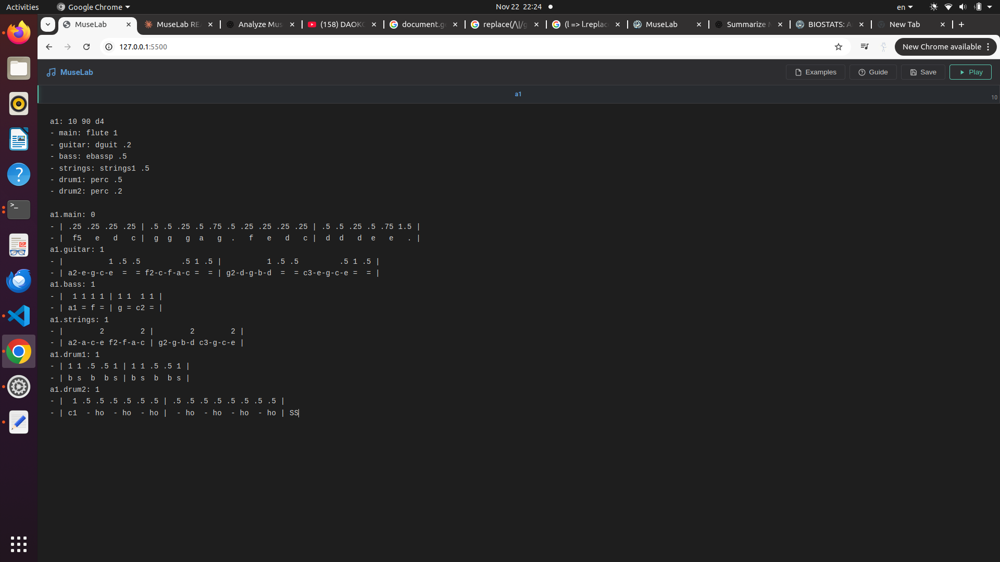

# MuseLab

A text-based music composer that runs in the browser. You write sections, tracks, rhythms and melodies as plain text, play them with General MIDI soundfonts, and export to MIDI, WAV or text.



## Quick Start

1. Open [MuseLab](https://hikarimusic.github.io/MuseLab/)
2. Paste this:
```
a1: 10 90 d4
- main: flute 1
- guitar: dguit .2
- bass: ebassp .5
- strings: strings1 .5
- drum1: perc .5
- drum2: perc .2

a1.main: 0
- | .25 .25 .25 .25 | .5 .5 .25 .5 .75 .5 .25 .25 .25 .25 | .5 .5 .25 .5 .75 1.5 |
- |  f5   e   d   c |  g  g   g  a   g  .   f   e   d   c |  d  d   d  e   e   . |
a1.guitar: 1
- |          1 .5 .5          .5 1 .5 |          1 .5 .5         .5 1 .5 |
- | a2-e-g-c-e  =  =  f2-c-f-a-c =  = | g2-d-g-b-d  =  = c3-e-g-c-e =  = |
a1.bass: 1
- |  1 1 1 1 | 1 1  1 1 |
- | a1 = f = | g = c2 = |
a1.strings: 1
- |        2        2 |        2        2 |
- | a2-a-c-e f2-f-a-c | g2-g-b-d c3-g-c-e |
a1.drum1: 1
- | 1 1 .5 .5 1 | 1 1 .5 .5 1 |
- | b s  b  b s | b s  b  b s |
a1.drum2: 1
- |  1 .5 .5 .5 .5 .5 .5 | .5 .5 .5 .5 .5 .5 .5 .5 |
- | c1  - ho  - ho  - ho |  - ho  - ho  - ho  - ho |
```
3. Tap play

## Notation

| Element | Syntax | Notes |
|---|---|---|
| Section | `name: [length] [tempo] [key]` | Set the section length (in beats), tempo (in bpm), and key (true pitch of `c4`) |
| Track | `- name: [instrument] [volume] [pan]` | Set the track instrument (use shortcut), volume (0 to 1), and pan (-1 to 1) |
| Select | `section.track: [offset]` | Select a track to start writing from `offset` (in beats) |
| Rhythm | `- [duration] [duration] ...` | Write rhythm as a list of durations (`1` = quarter note, `.5` = eight note, `2` = half note, ...) |
| Melody | `- [pitch] [pitch] ...` | Write melody as a list of pitches (`c4` = middle C, `gs3` = bass G sharp, `bf5` = treble B flat, ...) |
| Lyric | `- [text] [text] ...` | Write lyric if not rhythm (start with number) or melody (start with letter+number) |

| Symbol | Meaning |
|---|---|
| `c4` | Pitch. Notes without an octave use the octave of preceding note  |
| `c3-e-g` | Chord. Notes without an octave are placed at next higher pitch |
| `.` | Rest |
| `-` | Extend the previous note |
| `=` | Repeat the previous note or chord |
| <code>&#124;</code> | Bar line (optional) |

## Functions

| Function | Shortcut | Note |
|---|---|---|
| Play | `Ctrl + Enter` | Plays from the timeline position. Click the timeline to move it. Press again to stop |
| Save | `Ctrl + S` | Exports as MIDI (`.mid`), audio (`.wav`), or notation (`.txt`) |
| Guide | `Ctrl + G` | Shows the notation guide and the instrument, pitch and percussion shortcuts |
| Example | `Ctrl + E` | Loads an example song. You can also link to one with `?example=<name>` |

## Credits

- Player: [https://github.com/danigb/soundfont-player](https://github.com/danigb/soundfont-player)
- Soundfont: [https://github.com/gleitz/midi-js-soundfonts](https://github.com/gleitz/midi-js-soundfonts)
- Instrument: [https://github.com/mrbumpy409/GeneralUser-GS/tree/main](https://github.com/mrbumpy409/GeneralUser-GS/tree/main)
